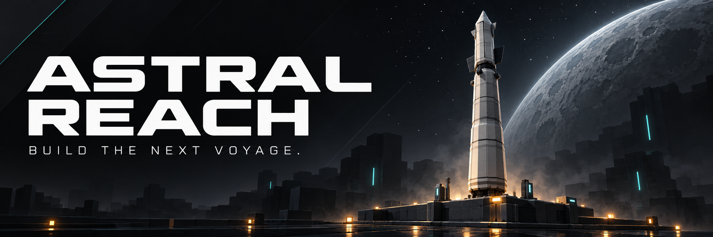
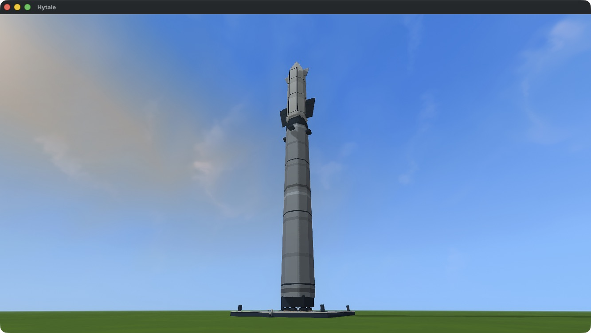
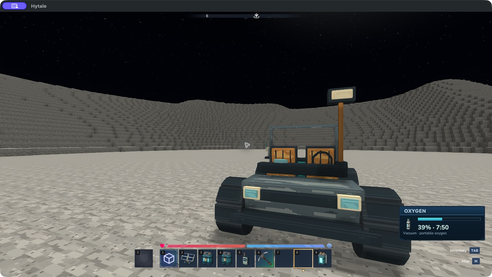

# Astral Reach

Gather resources, build full-size rockets and use finite fuel for a paid expedition to Lune.

**Early development — some features may be incomplete or may not work as expected.** Experimental builds are available on CurseForge; Alpha files may require enabling alpha versions in your launcher. Read the selected file’s notes and back up world and player data before upgrading.

**[Read the player guide](https://jkswoods.github.io/astral-reach/)** · [Rockets and scale](https://jkswoods.github.io/astral-reach/hytale0.7/rockets/) · [Launch platform](https://jkswoods.github.io/astral-reach/hytale0.7/launch-platform/) · [Gallery](https://jkswoods.github.io/astral-reach/hytale0.7/gallery/)

*Native Hytale 0.7.4 development capture: the full-size Kestrel Stack above its launch platform. Latest boarding and landing work remains under test.*

Astral Reach is a space exploration mod in development for **Hytale 0.7.\***. The current playable slice connects home-world nickel and oil shale, four fueled processors, a 25×25 multiblock launch site, ghost-blueprint construction and a paid expedition to Lune for titanium and aluminium. Suit upgrades, portable oxygen, oxygen fields and planet-themed masonry support the expedition. The native destination chart uses clickable planets and routes; press Esc to hide it and use `/astral-map` to reopen it in orbit.

| Rocket | Height | Maximum width | Launch pad |
| --- | ---: | ---: | ---: |
| Odyssey Heavy | 97.33 blocks | 16.96 blocks | 25×25 blocks |
| Kestrel Stack | 123.19 blocks | 19.31 blocks | 25×25 blocks |
| Saturn V | 110.62 blocks | 11.50 blocks | 25×25 blocks |
| Soyuz | 48.90 blocks | 9.11 blocks | 25×25 blocks |
| Space Shuttle | 55.56 blocks | 19.99 blocks | 25×25 blocks |

Start with the craftable **Explorer Tablet**: two sticks and one copper bar in Astral Assembly’s **Start here** tab. Its seven chapters explain your first launch, oxygen, Lune, stations and expeditions.

Build personal orbital stations with nine docking airlocks, power life support with solar arrays and batteries, and watch stations cross the Orbis sky. Rescue Beacons and Field Receivers guide invited rescuers. Lunar survey expeditions unlock a permanent fuel benefit and paid recipes for a forty-minute oxygen tank and a two-seat electric rover. New outposts and terrain appear only in unexplored Lune chunks.

*Actual Hytale 0.7.5 gameplay. The rover uses finite Beacon Cell power; its open seats still require a suit and oxygen.*

This branch contains the **runtime mod source and original assets**; versioned player documentation lives on `docs`. The guide follows the Hytale support branch; local client checks used Hytale 0.7.4 and 0.7.5. Check [Releases](https://github.com/jkswoods/astral-reach/releases) for compatible published files. Public documentation is available while the mod remains a development build. See [development status](https://jkswoods.github.io/astral-reach/hytale0.7/status/) before trying a candidate.

The [original model workshop](https://astral-reach-space-workshop.serina610406.chatgpt.site/) is a separate, earlier collection of 66 editable assets and proposed planets. Its model catalogue includes future content beyond the current playable route.

The [versioned player guide](https://jkswoods.github.io/astral-reach/) is maintained on the separate [`docs` branch](https://github.com/jkswoods/astral-reach/tree/docs). In that checkout, run `npm ci --ignore-scripts`, `npm run build` and `npm run check`. Select `docs` when manually dispatching its Pages workflow.

Astral Reach is an independent project and is not affiliated with or endorsed by Hytale or Hypixel Studios. See [credits and notices](https://jkswoods.github.io/astral-reach/hytale0.7/notices/).

## Compatibility and builds

Current source targets Hytale `>=0.7.3 <0.8.0` and uses the `hytale0.7` support branch. See [build and release instructions](https://jkswoods.github.io/astral-reach/hytale0.7/build-and-release/) for the SDK pin, candidate checks, versioned filenames and CurseForge workflow.

## Contributing

See [the contribution guide](CONTRIBUTING.md) for feature and bug-fix PR targets.
Maintainers handle forward/back ports, and support-branch PRs require owner approval.

The player guide follows the Hytale support line and is updated independently of mod releases. Select downloads by their game compatibility and read the selected file’s release notes for included changes and artifact checksums.
