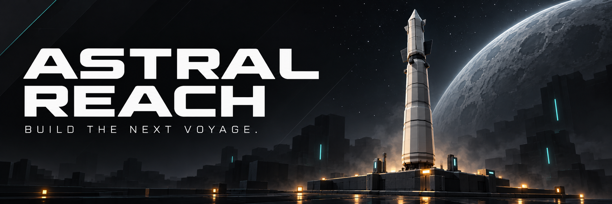
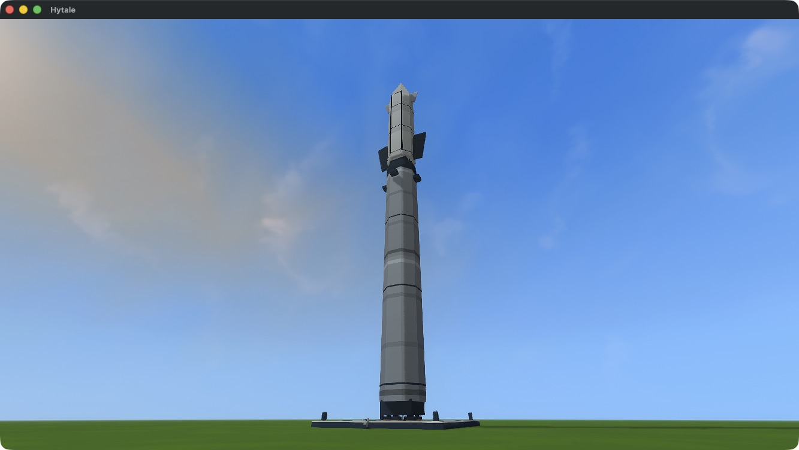

# Astral Reach

Gather resources, build full-size rockets and use finite fuel for a paid expedition to Lune.

**[Read the player guide](https://jkswoods.github.io/astral-reach/)** · [Rockets and scale](docs/rockets.md) · [Launch platform](docs/launch-platform.md) · [Gallery](docs/gallery.md)





*Native Hytale 0.7.4 development capture: the full-size Kestrel Stack above its launch platform. Latest boarding and landing work remains under test.*

Astral Reach is a space exploration mod in development for **Hytale 0.7.\***. The current playable slice connects home-world nickel and oil shale, four fueled processors, a 25×25 multiblock launch site, ghost-blueprint construction and a paid expedition to Lune for titanium and aluminium.

| Rocket | Height | Maximum width | Launch pad |
| --- | ---: | ---: | ---: |
| Odyssey Heavy | 97.33 blocks | 16.96 blocks | 25×25 blocks |
| Kestrel Stack | 123.19 blocks | 19.31 blocks | 25×25 blocks |

This repository contains the **player documentation, original guide branding and curated gameplay screenshots**. It does not currently distribute a playable JAR. The guide covers the 0.2.0-dev candidate; local client checks used Hytale 0.7.4. Public documentation is available while the mod remains a development build. See [development status](docs/status.md) before trying a candidate.

The [original model workshop](https://astral-reach-space-workshop.serina610406.chatgpt.site/) is a separate, earlier collection of 66 editable assets and proposed planets. Its model catalogue includes future content beyond the current playable route.

To build this guide locally:

```sh
python -m pip install -r requirements-docs.txt
python -m mkdocs build --strict
```

The generated guide is written to `build/player-site/`. The Pages workflow publishes it when manually dispatched; pull requests validate the documentation build.

Astral Reach is an independent project and is not affiliated with or endorsed by Hytale or Hypixel Studios. See [credits and notices](docs/notices.md).
