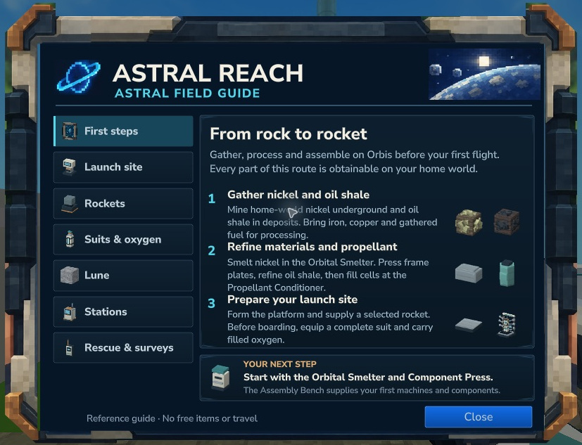

# Explorer Tablet {#explorer-tablet}

Keep the field guide with you from your first workshop to your lunar outpost. Craft one in the Assembly Bench’s first **Start here** tab for **2 sticks and 1 copper bar**. Crafting takes two seconds.

<figure><figcaption>The in-game field guide in native Hytale 0.7.5, cropped to its tablet case.</figcaption></figure>

Use the held tablet’s secondary action to open it. **/astral-guide** opens the same reference. Select a chapter on the left; Close returns to play.

| Chapter | What it helps with |
| --- | --- |
| First steps | Home-world gathering, processing and propellant |
| Launch site | The 25×25 platform, separate console and construction |
| Rockets | Choosing, funding, boarding and returned-part credit |
| Suits & oxygen | Suit tiers, reusable tanks and diffuser fields |
| Lune | Landing, exploration, resources and the prepaid return |
| Stations | Personal stations, docking and invited builders |
| Rescue & surveys | Rescue equipment and permanent expedition rewards |

The tablet is a reference: it supplies no items or free travel. Follow the normal native bench recipes and Flight Control checks. Equipment rewards must be earned and crafted.
