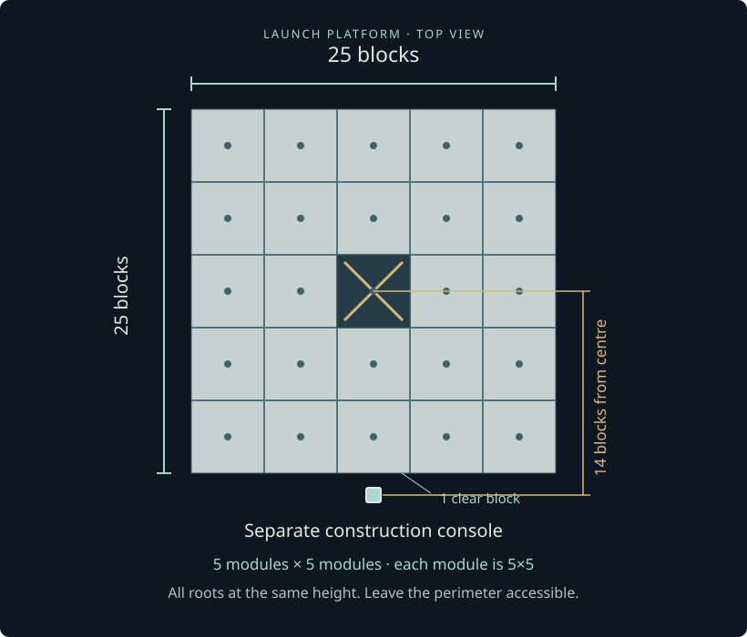
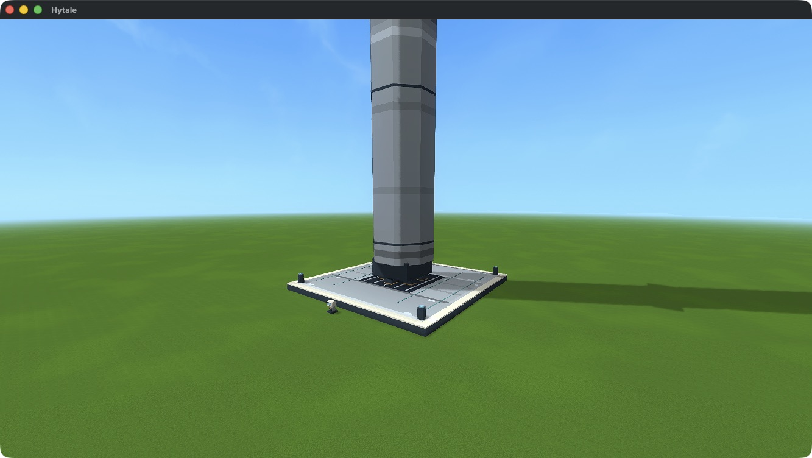
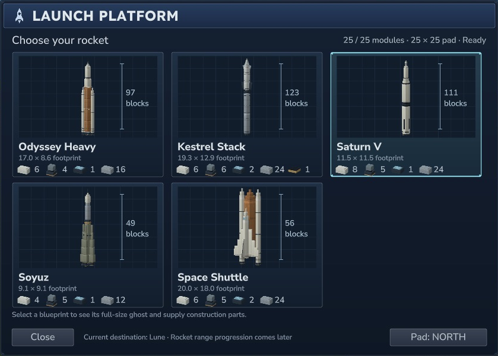
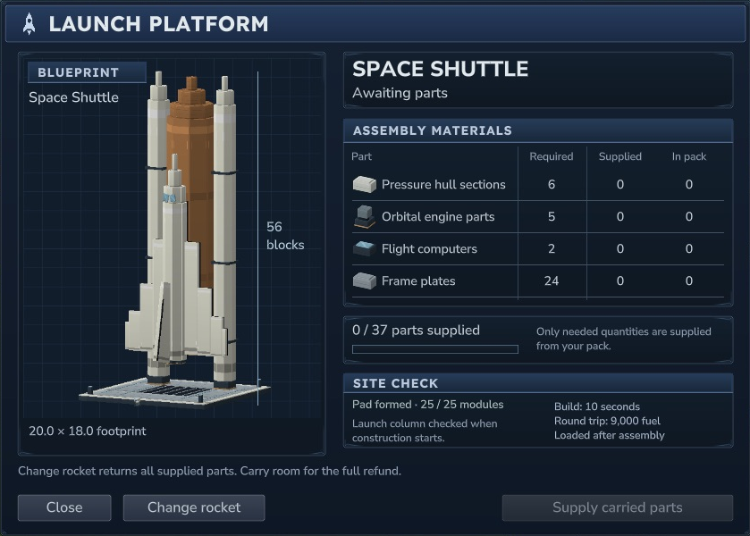
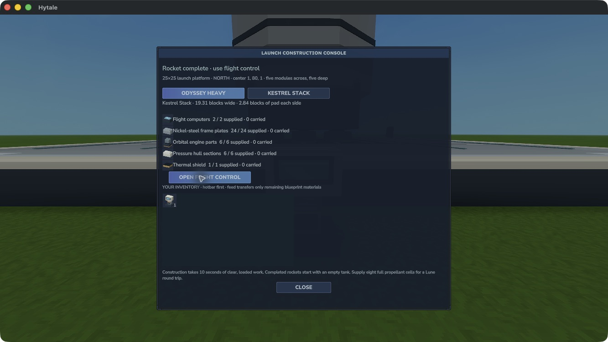

# Launch platform and construction console {#launch-platform-and-construction-console}

Build **25 Launch Pad Modules** in five touching rows of five, at the same height. Each module occupies **5×5×1 blocks**; their roots are five blocks apart. The completed structure forms one continuous **25×25** deck with a flame bed and corner beacons.

Each module costs **8 iron bars + 2 nickel ingots** at the Assembly Bench. The complete deck therefore costs **200 iron bars + 50 nickel ingots**.

<figure><figcaption>Top-down placement guide. Each large square is one 5×5 module. The console stands beyond the midpoint of an edge, with one clear ground block between it and the pad.</figcaption></figure>

## Place the separate console {#place-the-separate-console}

Craft a **Launch Construction Console** from **4 frame plates + 2 copper coils + 2 copper bars**. Place it at floor height outside an edge midpoint: its root is **14 blocks from the platform centre**.

Placing the console after a complete pad lets it recognise the direction. If placed first, it initially looks north. Use the **Pad** direction button before selecting a blueprint to choose another side. Keep the console and perimeter accessible.

<figure><figcaption>The formed pad reads as one launch structure. It extends beyond all five rocket footprints. Native launch-platform candidate, Hytale 0.7.4.</figcaption></figure>

## Choose a ghost blueprint {#choose-a-ghost-blueprint}

An unselected console opens **Choose your rocket**. Each card shows the actual model, height, footprint and full component costs. Choose Odyssey Heavy, Kestrel Stack, Saturn V, Soyuz or Space Shuttle. Selecting a card opens construction immediately and places its full-size cyan ghost above the pad. A preview accepts no fuel and cannot launch.

<figure><figcaption>Native Hytale 0.7.4 catalogue, cropped to the panel. Hover highlights the whole clickable card.</figcaption></figure>

The console remembers the selected blueprint. Reopening it, including after a normal save and reload, returns to construction. The materials table shows **Required**, **Supplied** and **In pack**. Choose **Supply carried parts** to transfer only missing quantities; you can supply the plan in stages. Paid items and partial work are saved.

| Material | Odyssey | Kestrel | Saturn V | Soyuz | Space Shuttle |
| --- | ---: | ---: | ---: | ---: | ---: |
| Pressure Hull Sections | 6 | 6 | 8 | 4 | 6 |
| Orbital Engine Parts | 4 | 6 | 5 | 5 | 5 |
| Flight Computers | 1 | 2 | 1 | 1 | 2 |
| Frame Plates | 16 | 24 | 24 | 12 | 24 |
| Thermal Shield | — | 1 | — | — | — |

<figure><figcaption>Actual construction screen on a formed pad. Supply is disabled because no required parts are carried. The launch column is checked when construction starts.</figcaption></figure>

Fully supplied construction takes **10 seconds** while the whole pad and launch column remain loaded and clear. The progress bar follows actual paid work. Missing modules or obstructions pause it, with a reason shown on the panel. Repair or clear the site to continue; use **Retry construction** if a fully supplied plan was blocked before it could start.

## Finish, recover and refuel {#finish-recover-and-refuel}

A completed build creates one owned rocket with an **empty tank**. The ghost disappears and a short fireworks celebration plays once. Reloading the completed yard does not replay it.

<figure><figcaption>A completed Kestrel, with its exact supplied materials and the separate Flight Control button.</figcaption></figure>

Before completion, **Change rocket** refunds the exact supplied items and returns to the catalogue. Make room for the complete refund; if it cannot fit, the console keeps the selected plan and its items. A returned spacecraft stays tied to its original blueprint and returned-part credit: **Return supplied parts** withdraws only your additional paid items. Drain and remove a finished idle rocket before starting another plan.

Choose **Open flight control** to deposit propellant. See [machines and propellant](machines.md) for the finite fuel chain.

## Leave airspace above the pad {#leave-airspace-above-the-pad}

Keep the standing rocket’s displayed height and footprint clear, with two extra blocks above the hull and enough room below the world ceiling. The check follows the selected ship’s actual size; it does not require the whole animated flight path to fit above the pad. A Kestrel built and completed its orbital flight from a pad at Y128 during local Hytale 0.7.5 checks.

In Creative, the construction and fuel Supply buttons work without inventory ingredients. Adventure still uses paid parts and propellant.
