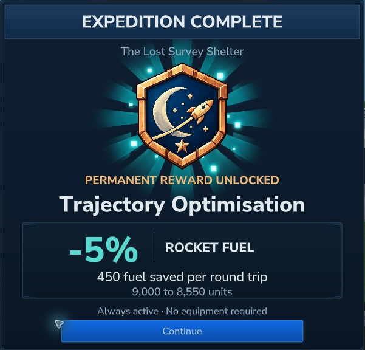
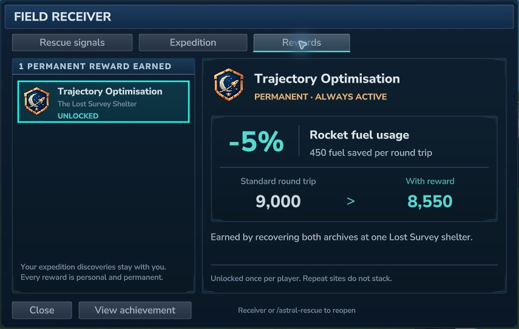
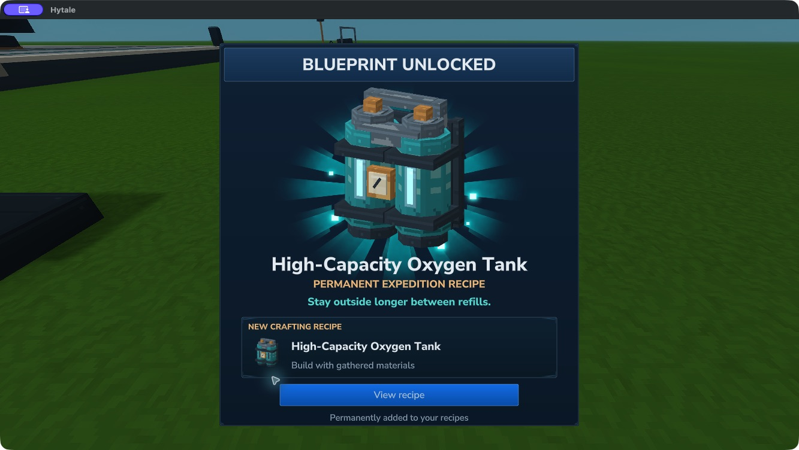
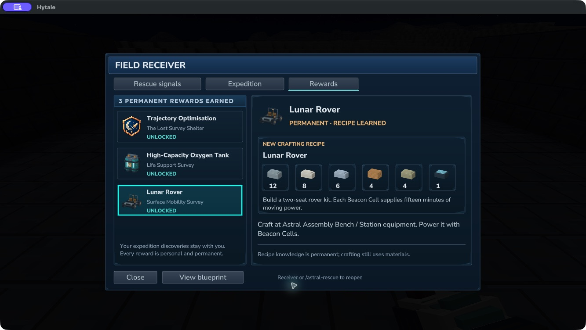
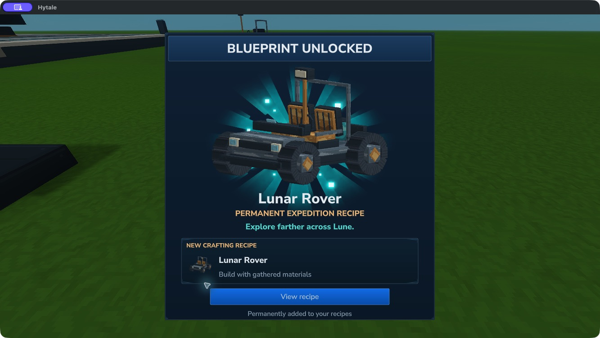
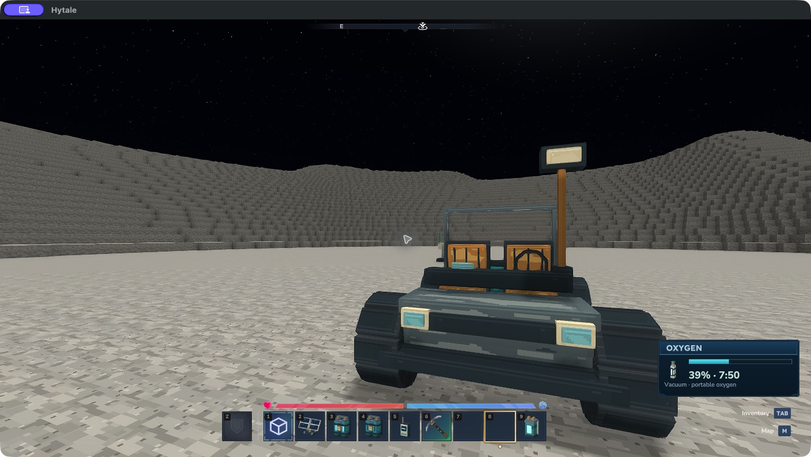

# Rescue and lunar expeditions {#rescue-and-lunar-expeditions}

::: warning Experimental content
Rescue multiplayer, the full expedition route and sound/comfort checks remain incomplete. Use backups and read your chosen download's notes for included features.
:::

Follow a lost survey team into Lune's lava tubes, recover their research and bring worthwhile salvage home. Carry spare oxygen, a light and a way back to your ship. The abandoned shelter has **no breathable air**.

## Pack a field kit {#pack-a-field-kit}

Craft these at the **Astral Assembly Bench → Station equipment**. All inputs can be obtained on Orbis before your first Lune trip.

| Item | Inputs | Purpose |
| --- | --- | --- |
| Rescue Beacon | 2 Frame Plates, 2 Copper Coils, 2 Nickel Ingots | Place a private distress transmitter |
| Beacon Cell | 1 Copper Coil, 2 Copper Bars, 1 Nickel Ingot | Power one beacon for 30 minutes |
| Field Receiver | 2 Frame Plates, 1 Copper Coil, 2 Nickel Ingots | Open rescue signals and expedition clues |

Each recipe takes four seconds. Hold the Field Receiver and use **secondary action**. **`/astral-rescue`** reopens rescue signals, and **`/astral-expedition`** opens the expedition page. In orbital navigation, **Rescue signals** opens the same receiver. Its Destinations button returns to the map only after you reach orbit.

## Call for help {#call-for-help}

Place a Rescue Beacon and use it with **F**. **Load cell** consumes one carried Beacon Cell and starts its thirty-minute battery. Invite up to **eight rescuers** by their exact online names. Only you and those invited players can see the signal; station invitations do not automatically grant rescue access. Enter an invited name and choose **Revoke** to remove access.

The owner must stand beside the beacon to load, broadcast, stop or change invitations. Its mast flashes while broadcasting. Stopping the signal, leaving its chunk or restarting the server **does not pause or refill its battery**. Removing the mast cancels the signal and discards its remaining charge.

The receiver shows the beacon's fixed location and remaining battery. If its owner is in the same world within **256 blocks**, it also reports their active oxygen canister and suit status. This is the active canister's normal breathing capacity, rather than a guarantee of survival time: sprinting, water and suit condition still matter. If the owner is away or the source world is unloaded, oxygen is explicitly unknown.

Choose **Track signal** for a compass direction, distance and height difference. From another world it names the destination; use your normal funded rocket route to get there. The beacon grants no travel, oxygen or protection. Bring spare canisters and arrange a way home with the stranded player. A real two-player rescue is still awaiting acceptance testing.

## Follow the survey {#follow-the-survey}

Open **Expedition**, then **Track surface relay**. A damaged relay stands beside a collapsed skylight. Inspect the original relay with **F** to recover the trail to a buried research shelter. Copper trail posts mark the drained lava channel. Two skylights and the shelter's two open doorways provide alternative approaches and exits.

The shelter contains two original Research Archives. Stand beside a terminal and choose **Recover data and salvage**:

- The survey archive gives **2 Titanium Ingots and 2 Frame Plates**.
- The evacuation archive gives **4 Frame Plates and 1 Flight Computer**.

Completing **both archives at the same site** also unlocks **Trajectory Optimisation**, a permanent **5% reduction in rocket propellant use** for that player. New departures cost **5,700 outbound + 2,850 protected for return**, or **8,550 total**. Your first unlock opens a dedicated reward reveal with its mission badge and the fuel saved per trip. Choose **Continue** to open the receiver’s **Rewards** tab, where the permanent benefit and **9,000 → 8,550** round-trip comparison remain available. Choose **View achievement** from an earned reward to revisit its reveal without receiving it again. Before completion, the expedition card and Rewards tab show a locked preview. The perk activates automatically; there is no item to equip or extra claim payment. Flight Control shows your actual price. Repeated generated copies of this expedition do not stack the perk. Previously completed journals receive it automatically.

This reward affects future launch payments. A journey already paid for keeps its original reserve and abort refund, including when the reward is earned while on Lune.

Each player can recover each terminal once per site. Make room for the whole reward; a full inventory leaves the archive unclaimed. The journal remembers recovered records across normal save/load. Exposed titanium and aluminium along the route can also be mined normally and do not regenerate.

Sites appear only in **newly generated Lune terrain**. Previously explored chunks and player builds are preserved. If a relay's location was explored before this expansion, choose **Next survey site** and travel to another region. Beacons and survey posts guide you, but the caves remain dark and unpressurised.

## Unlock expedition blueprints {#unlock-expedition-blueprints}

The equipment expansion adds two more missions to **Expedition**. Select a mission, track its first outpost and inspect the original field terminal with **F**. Recover the first record, follow the second outpost marker and recover its partner. **Both records must come from the same mission site**; records from separate sites cannot be combined.

| Expedition | Permanent recipe reward | What it adds |
| --- | --- | --- |
| Life Support Survey | High-Capacity Oxygen Tank | Twice the standard tank capacity |
| Surface Mobility Survey | Lunar Rover | A two-seat electric surface vehicle |

The unlock reveal has **View recipe**, opening real ingredient slots and quantities in **Rewards**. Recipe knowledge belongs to that player and survives normal saves. You still supply all crafting materials. Repeating a mission gives no extra copy, free equipment or stacking bonus. These outposts generate only in new Lune chunks; use **Next mission site** if the indicated terrain was explored before the update. All shelters and the rover's open cabin remain unpressurised.

These are actual Hytale 0.7.5 captures of the blueprint reveals and native ingredient view. The reveals can be reopened from **Rewards → View blueprint**.

### Build the larger oxygen tank {#build-the-larger-oxygen-tank}

After completing **Life Support Survey**, use **Suit Workbench → Survey equipment** to craft an **empty** tank from **2 Empty Oxygen Canisters, 4 Aluminium Ingots, 2 Titanium Ingots and 2 Copper Coils**. Crafting takes ten seconds. Fill it at an **Oxygen Collector on Orbis**; filling takes sixty seconds and the collector's normal processing fuel.

A full tank supplies **40 minutes of normal breathing**, **20 minutes underwater**, or about **26 minutes 40 seconds while continuously sprinting**. Those are nominal oxygen budgets; damaged or missing suit equipment can still expose you to hazards. Partial charge travels with the tank, the HUD uses its actual capacity, and its twin-cylinder backpack has a visible fill indicator. Depletion returns the matching reusable empty tank. Oxygen Diffusers can use either tank size.

### Build and drive the rover {#build-and-drive-the-rover}

After completing **Surface Mobility Survey**, craft the kit at **Astral Assembly Bench → Station equipment** using **12 Frame Plates, 8 Aluminium Ingots, 6 Titanium Ingots, 4 Copper Coils, 4 Nickel Ingots and 1 Flight Computer**. Assembly takes twenty seconds.

Use the kit's **secondary action** on clear, supported ground. Allow roughly three by four blocks and room for the lamp mast. A newly crafted rover has no charge. Its owner holds a **Beacon Cell** and uses **F** on the rover to install it. Each cell supplies **15 minutes of moving power**; two cells fit, for thirty minutes. Parking does not drain power. A complete cell must fit: partial cell charge is not discarded to top up a nearly full rover.

The owner uses **F** to drive. A visitor can use the second seat once the owner is aboard. **W/S** drives, **A/D** steers and **Dismount** exits (**F** by default). The rover stops at blocked or unloaded terrain and refuses large drops; drive around steep crater walls. Keep a suit and oxygen supply: the seats provide no breathable air.

Stop and empty both seats, then the owner can **crouch-F** to pack the rover back into its kit. Make inventory space first. Ownership and exact remaining energy survive native vehicle saves; packing and redeploying preserve the kit's charge and metadata. Reloaded riders return to an on-foot state rather than remaining attached to a stale vehicle reference.

*Actual Hytale 0.7.5 gameplay. Local checks cover the recipe unlocks, paid crafting, filling the larger tank, saving the learned recipes and carrying one charged rover kit to Lune for deployment, driving and F exit. Packing and redeployment preserve its remaining charge.*

The rover is experimental. Camera framing still needs polish, and the **Space brake input has not been positively verified**. Allow room to coast to a stop. Real passenger behavior, all collision cases, sound and comfort need further testing.

## A rougher lunar landscape {#a-rougher-lunar-landscape}

The terrain revision mixes fractured ridge fields and bare rock outcrops with broad crater bowls and quieter regolith plains. Rocky areas can have steep steps; walk around scarps and look for the smoother approaches to skylights. Landing clearings keep their established heights and level footprints. This terrain appears in newly generated chunks; existing explored terrain and player builds stay saved as they were. Native visual acceptance of the revised relief is still pending.

Small impact fragments also appear in newly generated terrain: Lunar Pebbles, Lunar Rocks and Lunar Rock Clusters. Debris forms uneven patches, with more in rocky regions and open stretches across the quieter plains. Landing clearings, skylight openings and relay platforms are kept clear. Mine a fragment to recover its matching decoration and place it elsewhere on a full supporting block. These rocks add no ore, fuel or progression shortcut.
