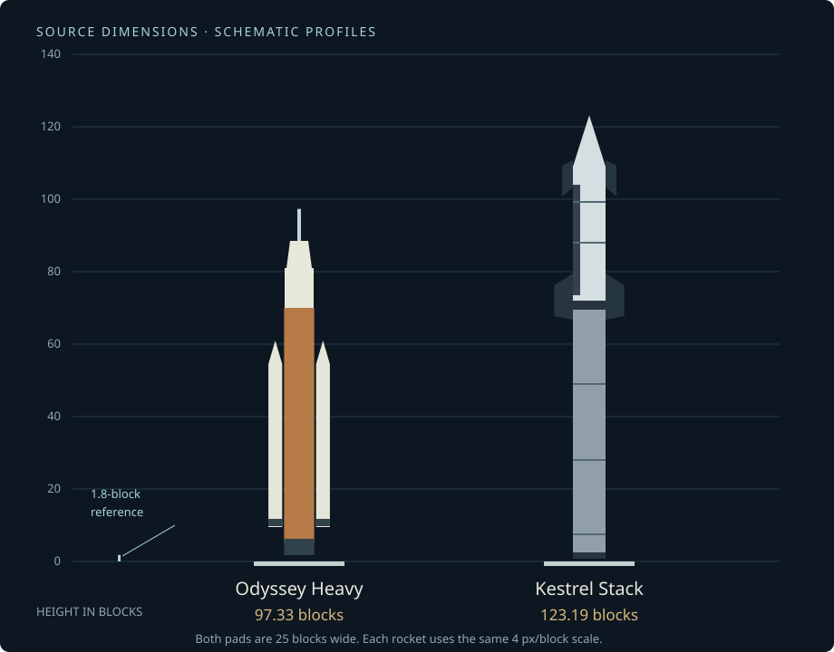
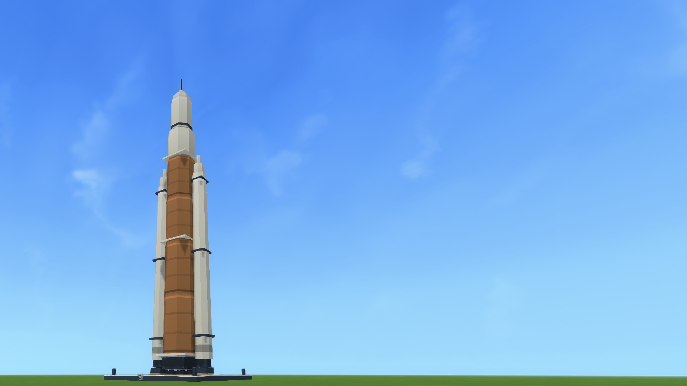
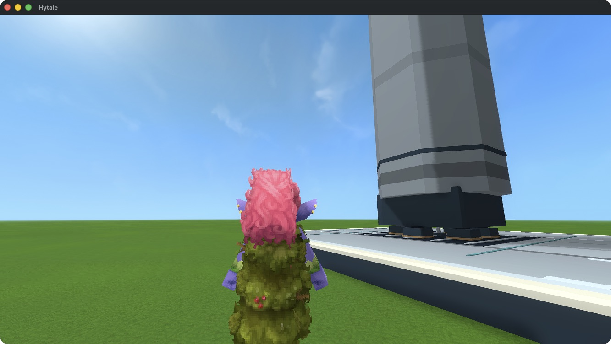
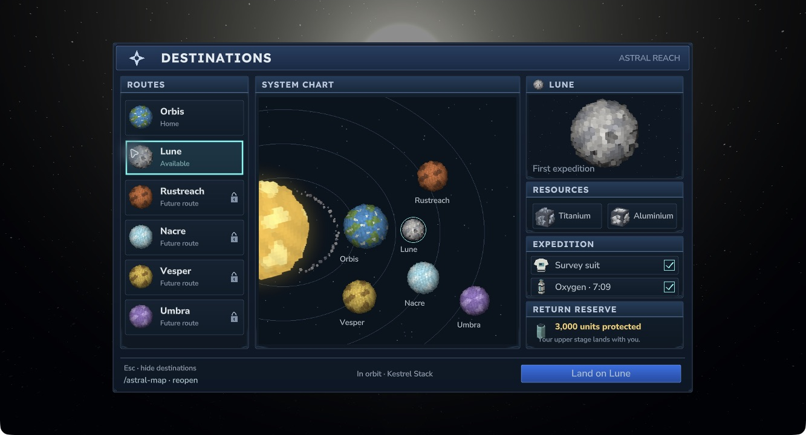
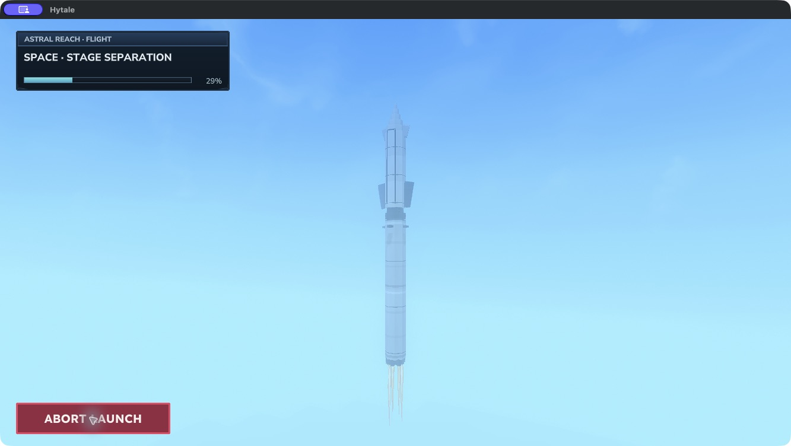
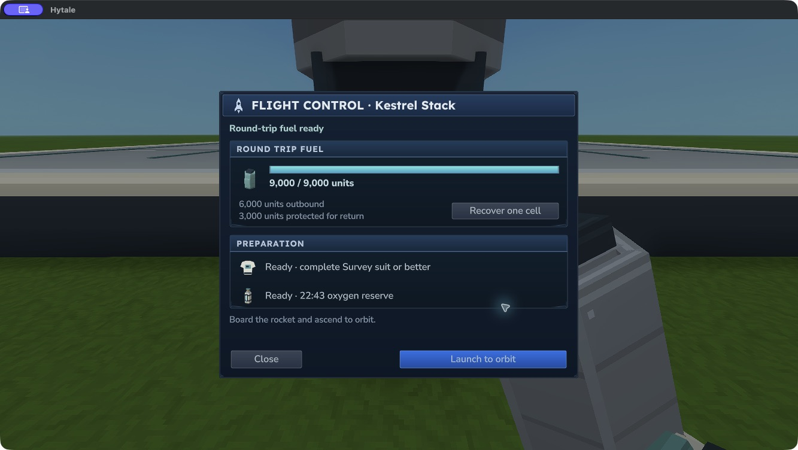

# Rockets and scale {#rockets-and-scale}

These ships are deliberately large. Plan the launch site around the complete silhouette, including boosters and upper fins.

| Rocket | Height | Maximum width | Maximum depth | Role |
| --- | ---: | ---: | ---: | --- |
| Odyssey Heavy | 97.33 blocks | 16.96 blocks | 8.62 blocks | First home-world-funded launcher |
| Kestrel Stack | 123.19 blocks | 19.31 blocks | 12.90 blocks | Larger reusable stack; requires a Thermal Shield |
| Saturn V | 110.62 blocks | 11.50 blocks | 11.50 blocks | Historical three-stage silhouette |
| Soyuz | 48.90 blocks | 9.11 blocks | 9.11 blocks | Four tapered strap-on boosters |
| Space Shuttle | 55.56 blocks | 19.99 blocks | 18.00 blocks | Winged orbiter, orange tank and twin boosters |

<figure><figcaption>A shared scale makes the difference explicit. The schematic profiles use actual model bounds at four pixels per block. The 1.8-block reference is about seven pixels high.</figcaption></figure>

## Odyssey Heavy {#odyssey-heavy}

A copper-orange core, two ivory strap-on boosters, crew capsule and escape tower give Odyssey its heavy-launcher silhouette. Its initial parts and fuel come from the home-world chain. It reaches the current paid Lune route without destination minerals.

<figure><figcaption>Odyssey at its complete native height. The 25×25 pad and separate console sit beneath the engine cluster. Native launch-platform development capture, Hytale 0.7.4.</figcaption></figure>

## Kestrel Stack {#kestrel-stack}

Kestrel combines a silver booster with a dark-tiled orbital ship, broad flaps, upper fins and multiple engine bells. Its widest point is **19.31 blocks**, including those upper fins. The pad leaves at least **2.84 blocks** of service width on either side.

<figure><figcaption>A ground-level player reference beside the lower stage. Perspective makes nearby objects larger; use the dimension diagram above for a true shared scale.</figcaption></figure>

The current flight gives Kestrel a separate booster and upper ship. Its locally tested sequence shows separation in space, the booster's flip and home-pad landing, then the orbital ship in space before navigation opens. The latest 90-second flight adds a longer ballistic fall and braking approach. Human visual and comfort acceptance remain pending.

## Historical fleet {#historical-fleet}

**Saturn V**, **Soyuz** and **Space Shuttle** join the console catalogue as original models with their own thumbnails, construction recipes, ghosts and flight-stage assets. Saturn V has broad black-and-white stage markings; Soyuz uses muted green tapered boosters; Shuttle carries a white winged orbiter with a dark ventral heat shield beside its orange tank. The same 25-block pad is wider than each complete stack.

Without expedition perks, all five plans currently use the same paid Lune route: **6,000 fuel outward and 3,000 for return**. Future range limits and progression between rocket types have not been added. The historical craft use game adaptations for upper-stage landing and return; this is not a simulation of their real mission capabilities. Only Kestrel currently performs the controlled returning-booster sequence.

The three new craft have representative placement, Use and construction checks. Complete flights with each new vehicle, final presentation, listening and multiplayer checks remain pending. Read the selected file's release notes for availability.

## Current flight limits {#current-flight-limits}

All five catalogue plans currently serve Lune. The spacecraft use decorative full-size exteriors and a compact control anchor; there is no walkable cabin or aerodynamic freeflight. Automatic passenger boarding and upper-stage landing are being tested in the current implementation. The new third-person ascent and orbital-navigation candidate is described on [development status](status.md).

The model workshop also contains the independent Kestrel upper ship, Peregrine explorer, Wren lander and additional infrastructure. Their presence in the art catalogue does not make them selectable playable vehicles. Peregrine is wider than the supported 25-block pad.

## Select a destination in orbit {#select-a-destination-in-orbit}

The redesigned **Destinations** screen becomes available after reaching space. Select a route in the list or click a planet on the top-down system chart. Its details show resources, equipment, available oxygen and protected homeward fuel. Use the single travel button to land on **Lune** or return to **Orbis**. Later bodies remain **Future route** entries with travel disabled.

The interface uses a simple clickable top-down system chart. Select a planet directly or use the route list. There are no drag, pan, zoom or separate 3D controls.

<figure><figcaption>Native Hytale 0.7.4 interface. Click a body or route; later destinations remain locked. The belt sits inside Orbis’s orbit.</figcaption></figure>

During a cancellable launch, the large red **ABORT LAUNCH** button stops the active departure and restores its reserved fuel. A local Hytale 0.7.4 test cancelled a real paid launch and returned all **9,000 units** to the rocket. The full tank persisted after a normal quit and reload.

Press **Esc** to hide Destinations and remain in orbit. The footer explains how to reopen it: type **`/astral-map`**. A reminder appears when the map is hidden. Hiding or reopening navigation does not spend the return reserve.

<figure><figcaption>Actual Hytale 0.7.4 capture during a paid launch, with Abort highlighted. Selecting it returned the player home and restored the reserved fuel.</figcaption></figure>

The revised interface has representative native selection, clean item icons, construction, paid travel and cancellation checks on Hytale 0.7.4. Human appearance, comfort, listening and multiplayer acceptance remain open. The gallery includes current native workshop and lunar photographs.

<figure><figcaption>The full tank after cancelling the launch, saving and reloading. This local functional test used staged fuel and equipment; it does not establish a complete survival walkthrough.</figcaption></figure>

The Lost Survey expedition reward permanently reduces that player’s new departure quote by 5%. Flight Control and construction preview show the adjusted price. Cancelling before orbit refunds the exact amount reserved for that departure. Existing paid journeys retain their original price.
