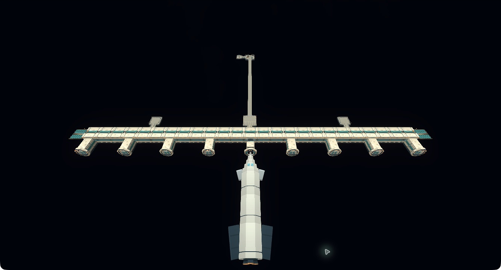
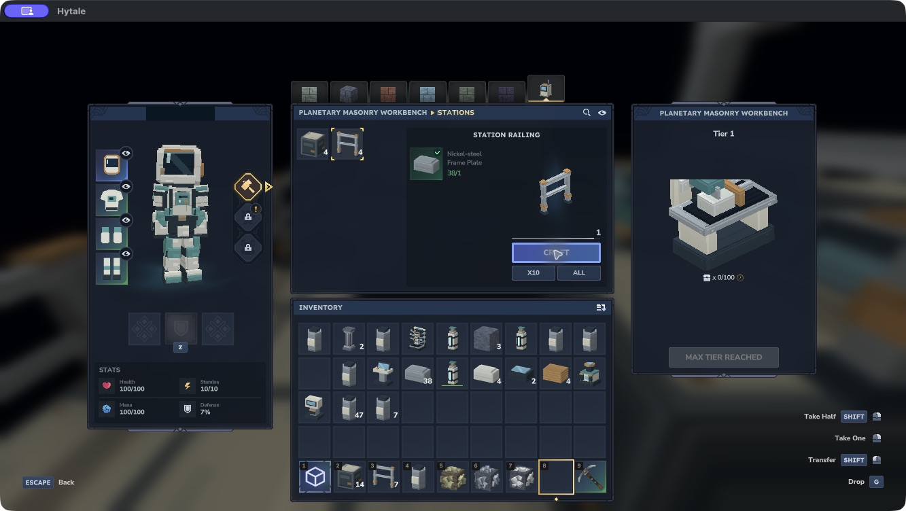
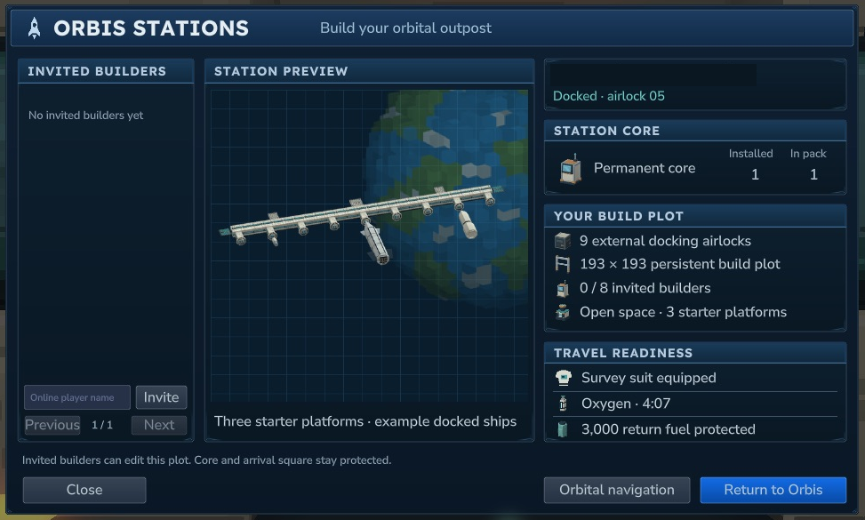
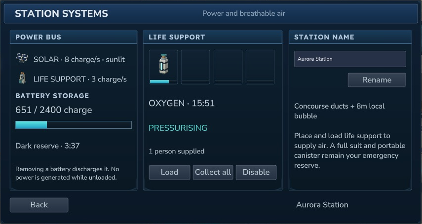
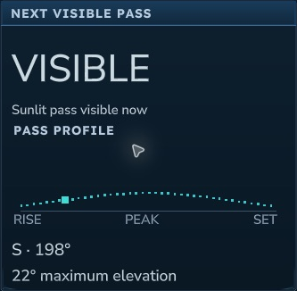

# Orbis orbital stations {#orbis-orbital-stations}

::: warning Experimental stations
Stations and physical docking are early implementations. Real multiplayer visiting, sound and some interrupted docking cases need further testing. Back up world and player data before upgrading.
:::

Craft a **Station Core**, take it on a funded rocket flight and deploy it from **Orbis stations** in the destinations screen. Your starter station is saved in Orbis orbit. Step out, build with normal blocks and expand it into a home above the planet.

<figure><figcaption>Actual Hytale 0.7.4 capture. The long rear bridge and distant deck belong to the preserved older prototype; new stations start with only the three small platforms.</figcaption></figure>

## Craft and bring supplies {#craft-and-bring-supplies}

At the **Astral Assembly Bench**, open **Components** and craft one Station Core:

| Input | Quantity |
| --- | ---: |
| Frame Plate | 32 |
| Pressure Hull Section | 4 |
| Flight Computer | 2 |
| Copper Coil | 4 |
| Oxygen Diffuser | 1 |

Crafting takes **12 seconds**. The Core includes a protected linear concourse, **nine exterior docking airlocks**, three small starter platforms and an **empty** oxygen diffuser. Wear a complete Survey suit or better and carry filled oxygen canisters. Deployment and docking require at least **four minutes of portable oxygen**.

Additional **Station Decks** and **Station Rails** are available in the **Stations** tab of the Planetary Masonry Bench. One Frame Plate makes **four** of either block in two seconds. Bring other building materials, tools and machines for your expansion.

<figure><figcaption>The native Stations tab uses real carried Frame Plates and normal crafting output. The player name is hidden.</figcaption></figure>

## Deploy and build {#deploy-and-build}

After reaching orbit, open **Orbis stations**, select **Your station** and choose **Deploy station**. A successful deployment consumes exactly one Core. Each player can own one permanent station.

One enclosed concourse runs along the edge of the station, with all **nine airlocks on its outer side**. Opposite them, a central **9×9 platform** and two **7×7 platforms** open into space where you can build your own habitats. There is no full floor across the construction area. Your **193×193** build plot extends vertically from **Y170 through Y319**. Use normal placement and mining to expand it. The permanent Core and the arrival square stay protected so returning players have a safe place to stand. Station relocation and resetting are not available in this first version.

Use the Core or an airlock terminal with **F**, or enter **`/astral-station`**, to reopen station controls. The command requires an existing funded orbital flight; it does not take you directly from Orbis into space.

<figure><figcaption>Use the permanent Core or an airlock terminal to manage builders or leave. The preview ships are illustrative. The player name is hidden.</figcaption></figure>

## Supply oxygen {#supply-oxygen}

Load filled canisters into the included diffuser. Inside its active field, the diffuser supplies oxygen and your portable canister waits on standby. Outside the field, your suit uses portable oxygen again. The diffuser has finite stored oxygen; keep spare canisters ready.

Walls and roofs alone do not pressurise a room. Oxygen collectors need an atmosphere, so fill canisters on Orbis and bring them with you.

## Invite builders and travel {#invite-builders-and-travel}

The owner can invite up to **eight builders** by entering an online player's exact name. Invited players can dock and build within the plot. They need their own funded flight, suit and oxygen. Removing an invitation removes access; machine inventories retain their existing ownership rules.

Choose **Orbital navigation** to return to the destinations screen, or **Return to Orbis** to begin your normal paid return journey. Docking and undocking preserve the existing return fuel reserve. The station remains saved when you leave.

Ships approach nose first, latch to a numbered airlock, then remain moored while their players are away. The owner uses **airlock 05**; the other eight serve invited players. Assignments persist independently of the invitation list. Undocking plays a release and pull-away sequence before orbital navigation. A normal reload at a completed dock retains the ship, airlock assignment and paid return reserve. A normal save during a moving approach also recovers safely at the assigned airlock. The departure-specific interruption check remains pending.

Existing prototype stations keep their original Core and player builds; the concourse is added outside their construction area.

The starter and crew controls are an early implementation. Fresh-station deployment, native docking with every ship, real second-client visiting, building and revocation checks remain pending. Distant station sections can also pop in during the approach at the shared test client’s view distance. See [development status](status.md) for the current test scope.

## Watch stations from Orbis {#watch-stations-from-orbis}

Deployed stations can appear as small, steady lights moving across the sky on Orbis and the Orbis Frontier. Look around dawn or dusk: reflected sunlight makes a pass easier to see against the darker sky. A station fades near the horizon or when it enters Orbis’s shadow. Bright daylight and precipitation hide the effect.

These are cosmetic views of real saved stations, including stations whose owners are offline. They do not create physical station copies on the surface. Several stations can have different paths, with at most three visible lights at once. The pass schedule survives a normal restart and continues when a Creative world’s day is paused. Viewing a light does not grant docking or building access.

The orbital timing is compressed for gameplay; a particular station is not always overhead. The moving light and bright-day suppression have been checked in Hytale 0.7.4. Human visual comfort, terrain and storm visibility, cold-start behaviour and agreement between two real clients remain separate checks.

## Station utilities {#station-utilities}

The station expansion adds a **Station equipment** tab to the **Astral Assembly Bench**. Each recipe makes one item in five seconds:

| Equipment | Inputs |
| --- | --- |
| Station Tracker | 4 Frame Plates, 2 Copper Coils, 1 Flight Computer |
| Telescope | 2 Frame Plates, 4 Copper Bars, 1 Void Crystal |
| Solar Array | 6 Frame Plates, 4 Copper Coils, 8 Copper Bars |
| Station Battery | 8 Frame Plates, 4 Copper Coils, 8 Iron Bars |
| Station Life Support | 1 Oxygen Diffuser, 2 Pressure Hull Sections, 4 Copper Coils |

Place solar arrays, batteries and life-support units **inside an orbital plot where you can build**. They share that station's power bus. The tracker is for use on Orbis. The existing oxygen diffuser remains a separate canister-powered device and needs no electricity.

The permanent solar wings together generate **4 charge/second** in sunlight. Each extra array adds **4 charge/second**. Each placed battery stores **2,400 charge**. Life support uses **3 charge/second** while enabled and supplied with oxygen. The twelve-minute power cycle includes an eclipse lasting about five minutes. One extra array and a battery provide a useful starting arrangement for one life-support unit. Only loaded, ticking equipment participates; leaving the server does not grant offline power. Removing a battery discards its charge.

Use a life-support unit with **F** to load up to **four real oxygen canisters**, switch it off or recover its canisters with their remaining charge. It supplies the permanent concourse ducts and an **eight-block local field** around the unit. It does not pressurise the whole building plot. Stored oxygen drains faster with more people: four full canisters last about **89 minutes for one person**. Walls alone do not create breathable rooms. Keep a full suit and spare portable canister for a power or oxygen failure.

The **Station systems** button at the Core opens the power overview. The station owner can also choose a name of up to **32 characters**. Only the owner of a life-support unit can load, collect or toggle its canisters. Power is shared with other utilities on the same station. Return controls stay available without power.

<figure><figcaption>Actual Hytale 0.7.4 controls. Current solar production, battery reserve and real stored oxygen. Active life support uses three charge per second.</figcaption></figure>

## Predict a pass and look closer {#predict-a-pass-and-look-closer}

Place a **Station Tracker** on Orbis and use it with **F**. Choose **Own**, **Invited** or **All**, then select a station. The screen predicts its next sunlit pass, bearing and maximum elevation. The pass profile shows rise, peak and set. It forecasts from your current location and the world's time settings; paused daytime can mean no visible pass in the search window. Clouds and terrain can still hide the view. Close the screen and use the same tracker again to reopen it.

The **Telescope** uses Hytale's native held-secondary spyglass interaction. Its implemented identification display and detailed view are intended to show the station's chosen name, owner and a simplified silhouette of the permanent concourse, docking points and solar wings. The silhouette does not reproduce every player-built room. Telescope zoom, aiming, station identification and detail visibility remain experimental and still need a successful in-game control check.

Station lights can briefly brighten as their panels reflect sunlight. Distant launch and return streaks are tied to actual flight phases and are omitted near the real rocket. They are cosmetic and do not create another ship or spend fuel. Agreement between independently controlled players and telescope detail remain pending checks in this expansion.

<figure><figcaption>The native pass profile updates as the saved station crosses the sky. This capture uses a paused dawn world; orbital motion continues.</figcaption></figure>
